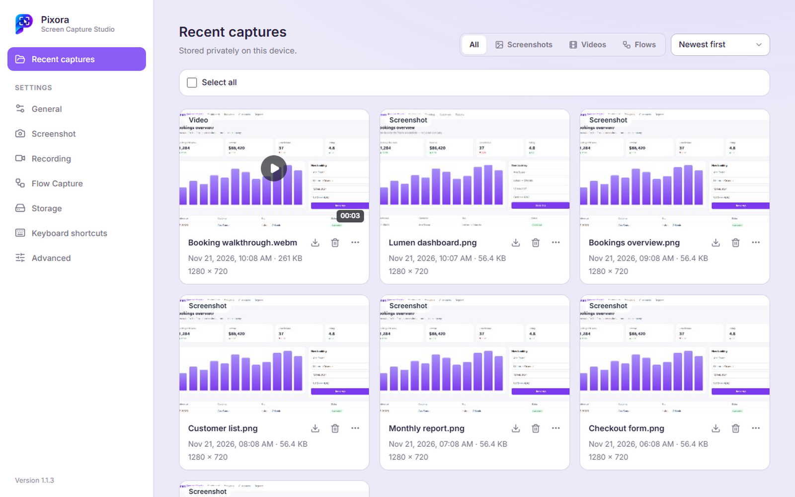
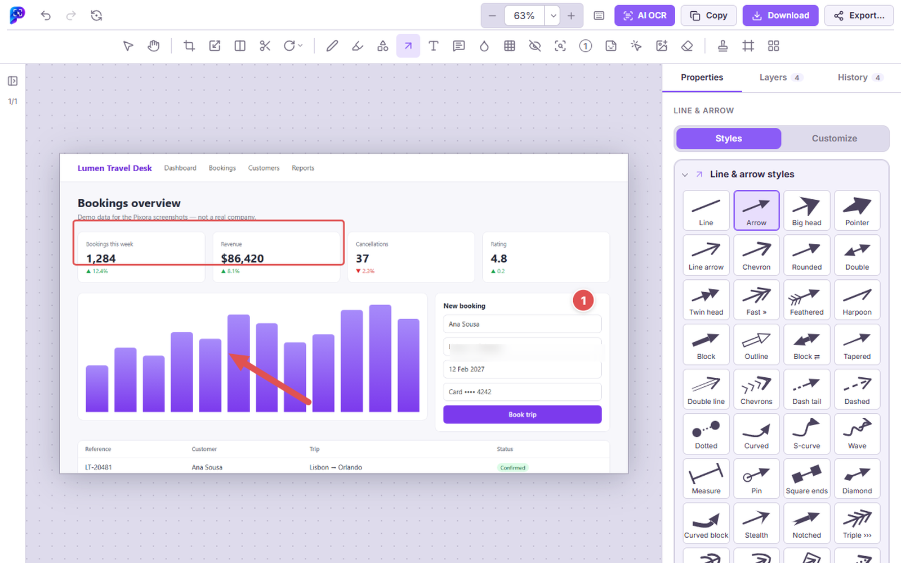
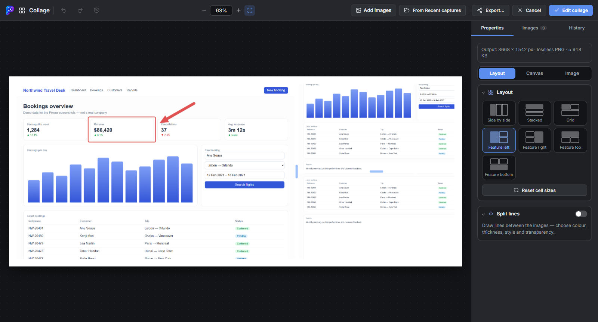
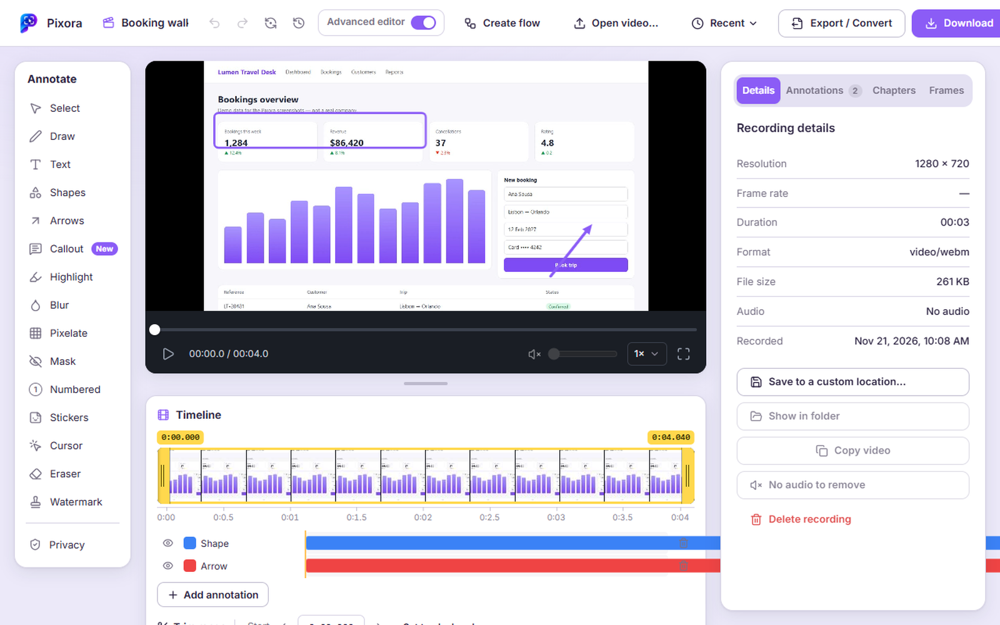
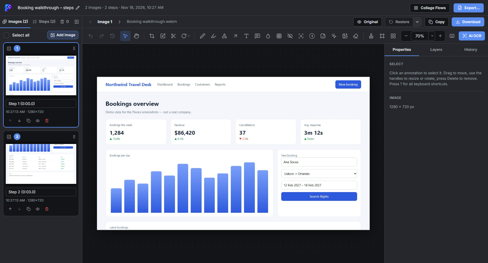

# Pixora – Screen Capture Studio

**Screenshots, screen recording and step-by-step guides — all on your own computer.**
No account, no uploads, no tracking.

Pixora is a Chrome extension (Manifest V3) for capturing and editing your screen: screenshots of the
visible part, a full page or a selected area, the whole screen or a window; a complete image editor;
tab, desktop and camera recording up to 4K with a video editor; and **Flow Capture**, which turns a
task you click through into a guide with a picture of every step.



**Version 1.1.3** · Chrome 116 or newer · [Release notes](docs/RELEASE_NOTES.md) · [Privacy policy](docs/PRIVACY.md)

---

## Features

### Screenshots
- **Visible part, full page, selected area, delayed** (3–300 s), **entire screen or app window** (with a countdown, optionally without the taskbar).
- **Full pages of any length:** fixed headers handled, lazy content loaded, panels that scroll on their own included (you choose which), table headers kept. Pages too tall for one image are saved as several full-resolution images. Progress and **Stop** are shown in Pixora's popup.
- **Real browser header (optional):** include your actual tabs, address bar and bookmarks bar on top of visible and full-page screenshots (Chrome asks which window to share).
- **Extract text (OCR)** on your device, and **find sensitive information** (emails, account numbers, keys) to hide.



### Image editor
- Pen, highlighter, shapes, **60+ line & arrow styles** (including Pointer and Swoosh), text with presets, callouts, numbered markers, stickers, cursors, blur / pixelate / mask, eraser, watermark.
- Crop, resize, rotate, **Cut out & join** (remove the middle of a long screenshot), browser and device frames, backgrounds and borders.
- **Image panel:** work on several images at once, add images from a file, the clipboard or a web address, **Compare** before / after, make a **Collage**.
- Every change stays editable (Layers, History); originals are kept.
- Export **PNG, JPEG, WebP, PDF or Word**, a QR code for a link, copy to the clipboard, or save to any folder.



### Screen recording
- Record **this tab, a custom area, your desktop or a window, or your camera** — up to 4K, MP4 or WebM.
- Microphone and system / tab audio, camera bubble (shape, size, position, border), countdown, pause / resume.
- **Live tools from the popup:** zoom (click where, or drag an area), highlight an area, spotlight, draw on the screen, chapter markers, teleprompter, mic and camera on / off. The recording pauses while you choose an area, so Pixora's controls are never recorded.
- Click effects, cursor halo, keyboard-shortcut highlights, auto zoom on click.



### Video editor
- Filmstrip timeline with trim, preview selection, chapters (WebVTT export), frame grabs.
- **Annotations on the video:** the image editor's tools drawn over the video, each with its own time on the timeline, entry / exit animations (fade, slide from any side, zoom, …), effects and movement over time — burned into the export.
- **Privacy regions** (blur / pixelate / mask) over a time range.
- Export / convert to MP4 or WebM, 240p–4K, with or without audio; open your own video files too.

### Flow Capture
- Click through a task: Pixora captures a picture of each step (and, if you like, writes the step — “Click *Save*”, “Type in *Email*”). Works while recording video too.
- Passwords and sensitive fields are always masked.
- **Flow Editor:** edit each picture, reorder, describe, then export **PDF, HTML, ZIP, JSON** or separate files.



---

## Privacy

Everything is processed and stored on your computer (in the extension's own storage, or in files you
save). Pixora has no server, no analytics and no advertising, and never uploads your captures. Access
to a website is asked for only when it's needed for something you start, and can be declined. Full
details: [docs/PRIVACY.md](docs/PRIVACY.md) and [docs/PERMISSIONS.md](docs/PERMISSIONS.md).

## Install

**From the Chrome Web Store:** search for *Pixora – Screen Capture Studio* and click *Add to Chrome*.

**From source (developers):**

```bash
npm install
npm run build          # type-checks, then builds into dist/
```

1. Open `chrome://extensions` and turn on **Developer mode**.
2. Click **Load unpacked** and select the `dist/` folder.
3. Pin **Pixora** (puzzle icon → pin) and click it.

## Keyboard shortcuts

| Shortcut | Action |
| --- | --- |
| Alt+Shift+G | Open Pixora |
| Alt+Shift+V | Capture the visible part |
| Alt+Shift+F | Capture the full page |
| Alt+Shift+A | Capture a selected area |

More (start / pause / stop recording, chapter marker, draw on the screen, Flow Capture step, open the
editor) can be assigned at `chrome://extensions/shortcuts`. In the editor, press **?** for every shortcut.

## Building a release

```bash
npm ci
npm test                               # unit + integration tests
npx playwright test --workers=1        # end-to-end tests in real Chromium
npm run package                        # build + release check + release/pixora-<version>.zip
```

`npm run package` checks the build before zipping it: no remote code, no `eval`, every file the manifest
names is present, no required website access, and the store summary is within 132 characters. Upload
`release/pixora-<version>.zip` to the Chrome Web Store. The submission sheet (listing text, permission
justifications, privacy answers, images) is [docs/STORE.md](docs/STORE.md).

The unpacked extension is about 18 MB (the zip about 9 MB); most of it is the offline OCR engine and
its English language data, so text recognition works without a network.

## Development

| Command | What it does |
| --- | --- |
| `npm run build` | Type-check, build the pages and service worker (Vite), bundle the content script, copy the offline OCR files, run the release check |
| `npm run dev` | Rebuild on change (then press ↻ on the extension card in `chrome://extensions`) |
| `npm run typecheck` | TypeScript strict-mode check only |
| `npm test` | Unit and integration tests (Vitest, jsdom, fake IndexedDB, mocked `chrome.*`) |
| `npm run test:e2e` | End-to-end tests in real Chromium via Playwright (`SKIP_BUILD=1` reuses `dist/`) |
| `npm run package` | Release zip (see above) |
| `npm run icons` | Regenerate the PNG icons |

First end-to-end run: `npx playwright install chromium`. Recording tests open a visible browser window
(MediaRecorder produces no data in headless Chromium). See [docs/DEVELOPMENT.md](docs/DEVELOPMENT.md).

**Debugging:** service worker — `chrome://extensions` → Pixora → *Inspect views: service worker*;
popup — right-click the toolbar icon → *Inspect pop-up*; stored data — DevTools → Application →
IndexedDB → `glint-capture`; verbose logs — Settings → Advanced → *Debug logging*.

## Documentation

| Document | Contents |
| --- | --- |
| [docs/RELEASE_NOTES.md](docs/RELEASE_NOTES.md) | What's in this release, known limitations |
| [docs/FEATURES.md](docs/FEATURES.md) | Every feature, how it is verified, and the change log by round |
| [docs/ARCHITECTURE.md](docs/ARCHITECTURE.md) | Execution contexts, messaging, recording pipeline, storage |
| [docs/PERMISSIONS.md](docs/PERMISSIONS.md) | Why each permission is needed |
| [docs/PRIVACY.md](docs/PRIVACY.md) | Privacy policy (publish it and link it in the store listing) |
| [docs/STORE.md](docs/STORE.md) | Chrome Web Store submission sheet |
| [docs/DEVELOPMENT.md](docs/DEVELOPMENT.md) | Project layout, conventions, testing, manual test checklist |

## Chrome limitations (and what Pixora does instead)

| Limitation | Behaviour in Pixora |
| --- | --- |
| Restricted pages | `chrome://` pages, the Web Store and the PDF viewer can't be captured as tabs; use *Entire Screen & App Window* |
| Tab capture needs a click on that tab | Works from the popup or a keyboard shortcut; scheduled *tab* recordings need one click if the tab changed |
| Desktop capture always shows Chrome's picker | The picker opens in Pixora's recorder tab; Entire-screen screenshots wait (3 s or more, with a countdown) after you pick |
| System audio | Windows / ChromeOS: entire screen or tab audio. macOS: tab audio only. Tick “Share audio” in the picker |
| Mouse cursor | Always in desktop recordings, never in tab recordings; click effects and the cursor halo show interactions |
| Cursor outside the tab | Cursor-following zoom / spotlight work in tab recordings; desktop recordings zoom where you click or the area you pick |
| Very tall pages | One image can be about 32 000 px per side; longer pages are saved as several full-resolution images |
| Native MP4 recording | Used when Chrome supports it; otherwise Pixora records WebM and converts to MP4 on the result page |
| 4K | Needs a 4K source; Pixora records the real source pixels and never upscales |
| Copy video | Browsers can't put video files on the clipboard; download or save instead |

## Copyright

Copyright © 2026 the Pixora author. All rights reserved. The source is published for reference; no
licence to use, copy, modify or distribute it is granted.
