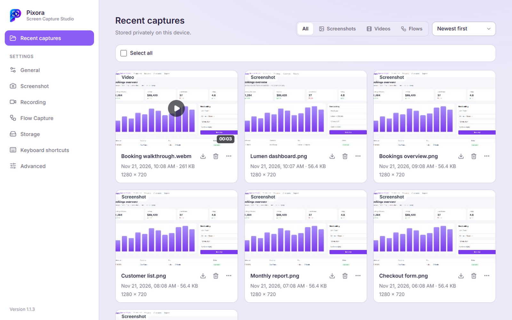
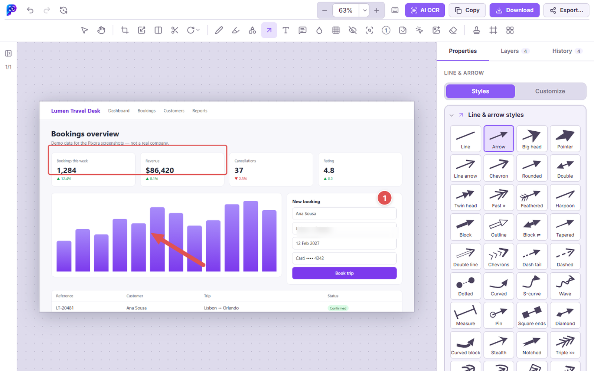
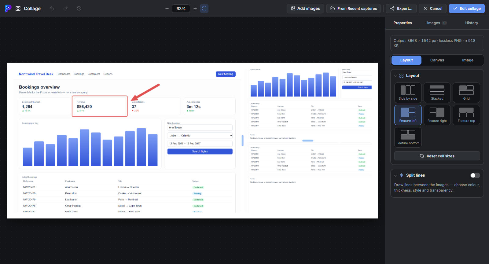
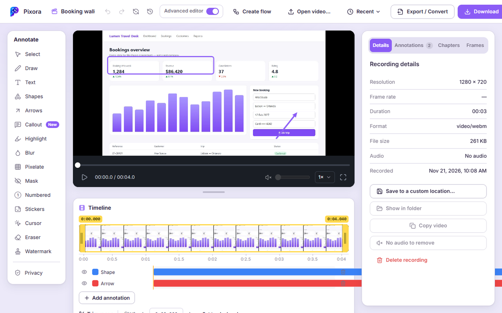
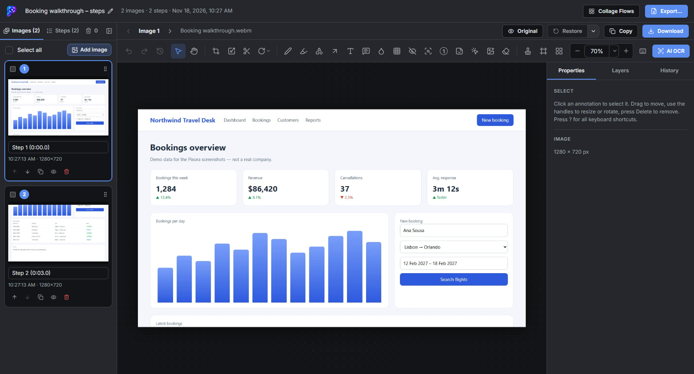
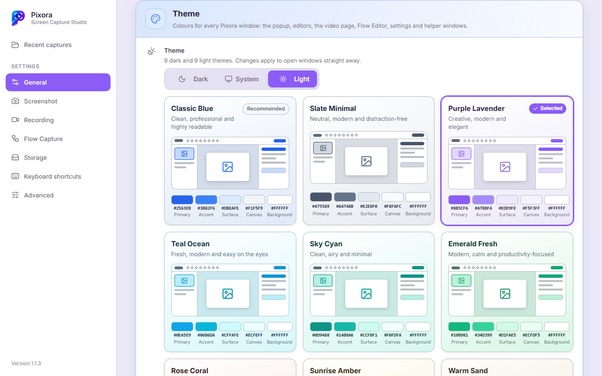

# Pixora – Screen Capture Studio

Screenshots, screen recording and step-by-step guides for Chrome — all on your own computer.
**No account, no uploads, no tracking.**

**[Add Pixora to Chrome — free on the Chrome Web Store](https://chromewebstore.google.com/detail/domfaochimmiimphibbkbhmkbcfeijff)**
· Version 1.1.3 · [Release notes](RELEASE_NOTES.md) · [Privacy policy](privacy/)

## What's new in 1.1.3

- **Right-click menu** — every capture and recording from the right-click menu of any page, and
  *Annotate this image* on pictures.
- **Blur, pixelate and mask** — apply to an area, everything outside it or the whole picture; pick
  each part of the look (effect, strength, shape, edges, colour, glass, border) on its own.
- **Better on a Mac** — shortcuts shown as ⌘ ⌥ ⇧, ⇧⌘Z redo, ⌘⌫ delete, Option keys shown right.
- **Pictures from a web address** in the editor; screen and window screenshots count down on the
  toolbar icon; smoother sliders.

## New in 1.1.2

- **Click highlights, redesigned** — a live preview you can try, smooth animations for every click
  effect, the cursor shown with each click (any design, size, colour and motion, with the mouse
  button pressed), quick looks, and highlights on every page you visit while recording.
- **Cursor tool** — the same looks, designs, effects and motions in the image editor, with an
  animated preview; cursors in videos can play their click animation.
- **Taller video** — drag the bar under the video to make it bigger for drawing.

## New in 1.1.1

- **Video editor** — Undo, Redo, a History window and Reset to original. Annotations keep their size
  when you export at a lower resolution, and the export bar shows the real progress and time left.
- **Callouts** — move the title and text anywhere, choose the colour of the leader line's end point,
  and keep the shape when the text size changes.
- **Faster editing** — select several objects with Ctrl + Shift + click, hold Shift to resize shapes
  as squares or circles, and hold + or − to change the text size.
- **Lock and Move only**, **cut a highlight with a shape**, a movable watermark, and blur that also
  covers the annotations beneath it.

## New in 1.1.0

- **Themes for every window** — choose Dark, System or Light, then one of 9 dark or 9 light themes
  (Graphite Dark is the default). Colours are tuned to be easy on the eyes, and the popup, editors,
  settings and helper windows all follow your choice.
- **Browser header in screenshots** — visible-part and full-page screenshots can include the real
  tabs, address bar and bookmarks bar.
- **Create a flow from a video** — pick frames of a recording and turn them into a step-by-step guide.
- **Faster full pages** — the editor opens straight away while a long page is prepared; exports show
  their progress, and screenshots you haven't changed download instantly.
- **Redesigned settings**, a **System sound** button for recordings, smoother Recent captures and
  many fixes. See the [release notes](RELEASE_NOTES.md) for everything.

## Screenshots

Capture the **visible part**, the **full page** (sticky headers handled, long pages split into
several images), a **selected area**, the **entire screen or an app window**, or take a screenshot
after a delay. Then annotate it in the editor: arrows, shapes, text, callouts, highlights, blur,
pixelate and mask for private details, numbered steps, stickers, frames, crop, resize, and text
recognition (OCR) that runs on your computer.

## Collages

Put several screenshots side by side, stacked or in a grid, resize the cells by dragging the gaps,
and zoom or move each image inside its cell.

## Screen recording

Record a tab, a window or the whole screen, with your microphone, system sound and camera. Trim the
result, add chapters, blur private areas over time, draw timed annotations with animations, and
export to MP4 or WebM at the size and quality you choose — all on your computer.

## Flow Capture — step-by-step guides

Turn on Flow Capture and use a website as usual: Pixora takes a screenshot at every step (clicks,
form fields, page changes) and writes the step down. Edit any image in the Flow Editor and export the
guide as PDF, Word, HTML, a ZIP, separate image files or JSON. You can also build a flow from
frames of a recording.

## Themes

## Private by design

Everything stays on your computer. Pixora has no account, no server, no analytics and no advertising,
and it never uploads your screenshots, recordings or anything else. Read the full
**[privacy policy](privacy/)** and **[why each permission is needed](PERMISSIONS.md)**.

## More

- [Features in detail](FEATURES.md)
- [Release notes](RELEASE_NOTES.md)
- [Permissions and why they are needed](PERMISSIONS.md)
- [Source code on GitHub](https://github.com/RameshNR/Pixora-Screen-Capture-Studio)
